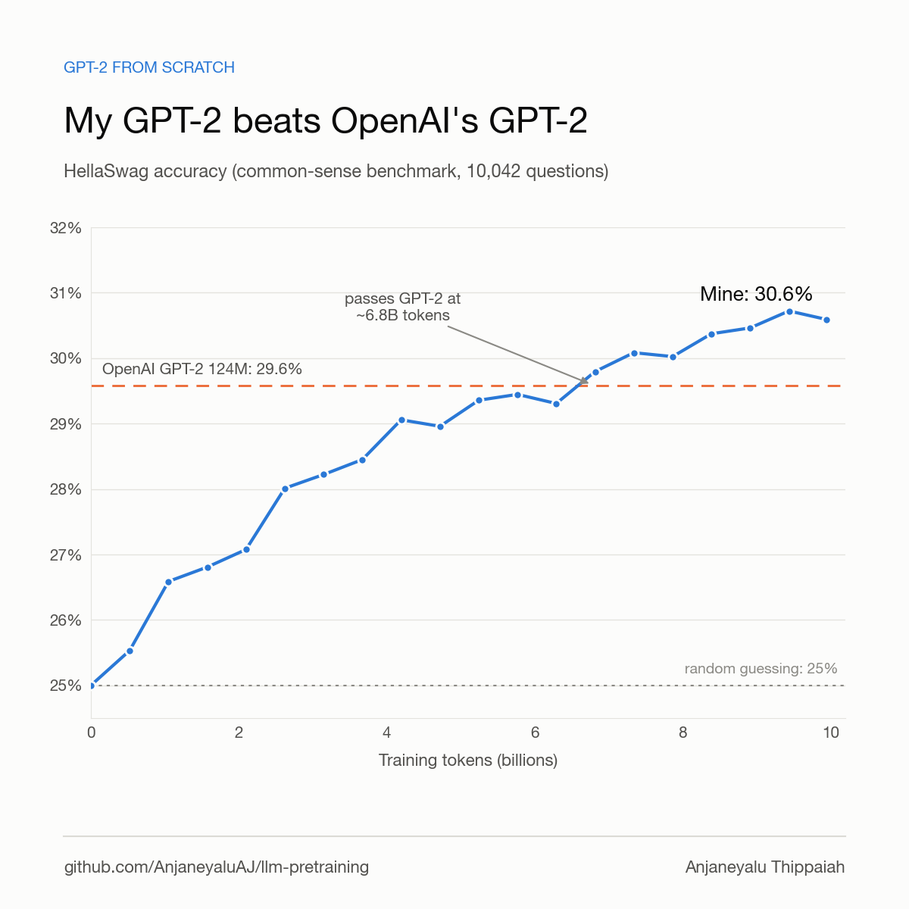
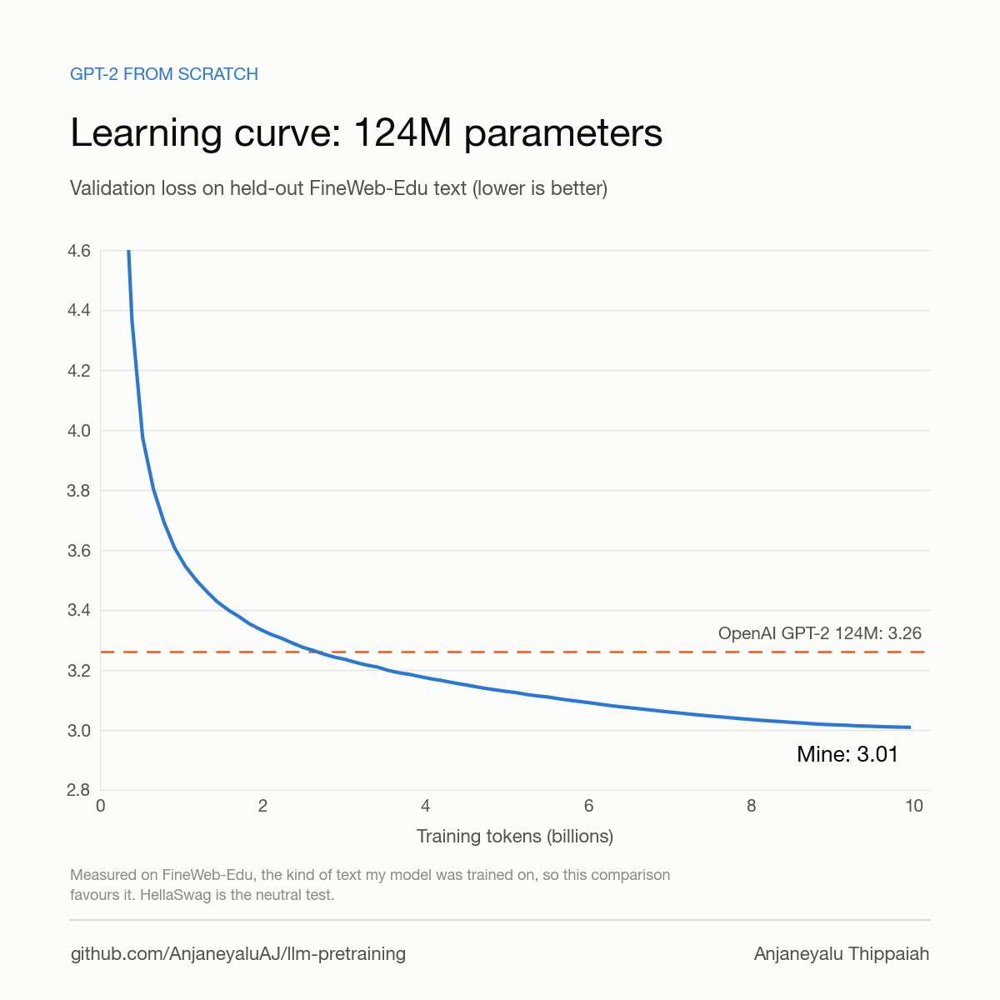

# GPT-2 124M from scratch on FineWeb-Edu

A from-scratch reproduction of GPT-2 small (124M parameters), trained with this repo on
9.9B tokens of [FineWeb-Edu](https://huggingface.co/datasets/HuggingFaceFW/fineweb-edu)
(`sample-10BT`). It beats OpenAI's GPT-2 124M on HellaSwag.



## Results

Both models were scored with this repo's code (`hellaswag.py`, `evaluate.py`) on the same data.

| | OpenAI GPT-2 124M | **This run** |
|---|---|---|
| HellaSwag acc_norm (10,042 val examples) | 29.58% | **30.59%** |
| HellaSwag acc | 28.56% | **29.14%** |
| FineWeb-Edu val loss | 3.262 | **2.990** |
| FineWeb-Edu val perplexity | 26.10 | **19.89** |
| FineWeb-Edu val next-token accuracy | 39.41% | **42.12%** |
| FineWeb-Edu val bits per byte | 1.019 | **0.934** |

- **HellaSwag is the neutral comparison**: neither model trained on it. This run passes
  OpenAI's score at about 6.8B tokens (step 13,000) and finishes one point ahead.
- **The FineWeb-Edu numbers favour this run**, because they are measured on held-out text
  from the same distribution it was trained on. They show what it learned, not a fair
  head-to-head.
- Our HellaSwag score for OpenAI's GPT-2 (29.58%) matches the 29.55% reported in
  [karpathy/build-nanogpt](https://github.com/karpathy/build-nanogpt), which checks the
  evaluation code.
- The final val loss in the chart below (3.01) is the in-training estimate on 20 batches
  per GPU. The table uses `evaluate.py` on the whole validation split (2.99).



## Samples (greedy decoding)

| prompt | OpenAI GPT-2 124M | this run |
|---|---|---|
| The meaning of education is | not the same as the meaning of life. The meaning of education is not the same as the meaning of life. ... | to provide a means of acquiring knowledge and skills. It is a process of acquiring knowledge and skills. ... |
| Photosynthesis is the process | of converting carbon dioxide into energy. The process is called "carbon capture and storage" (CCS). ... | by which plants convert sunlight into energy. |

## Setup

| | |
|---|---|
| Model | GPT-2 124M (`gpt2-124m` preset): 12 layers, 768 wide, 12 heads, context 1024, tied embeddings, no dropout |
| Data | FineWeb-Edu `sample-10BT`: 9,944,035,344 train / 9,953,989 val tokens, GPT-2 tokenizer |
| Batch | 524,288 tokens per step (4 GPUs x 16 sequences x 1024 tokens x 8 accumulation steps) |
| Steps | 18,966 (one epoch) |
| Optimizer | AdamW, lr 6e-4, 700 warmup steps, cosine decay to 6e-5, betas 0.9 / 0.95, weight decay 0.1, grad clip 1.0 |
| Precision | bf16 autocast, `torch.compile` |
| Hardware | AWS g5.12xlarge: 4x NVIDIA A10G 24 GB (PCIe) |
| Throughput | ~177k tokens/s, ~54% MFU (A10G bf16 peak taken as 70 TFLOP/s) |
| Time and cost | 16.4 hours including evaluations, about $93 on-demand |

Exact config: [`config.yaml`](config.yaml) (same as
[`configs/gpt2_124m_fineweb_a10g.yaml`](../../configs/gpt2_124m_fineweb_a10g.yaml)).

## Reproduce

```bash
export HF_HOME=/mnt/nvme/hf
python scripts/download_fineweb_edu.py --sample 10BT --out /mnt/nvme/raw/fineweb-edu      # ~27 GB, under a minute
python prepare_data.py --input /mnt/nvme/raw/fineweb-edu/sample/10BT \
    --output_dir /mnt/nvme/tok/fineweb-edu-10bt --val_fraction 0.001 --num_proc 44        # ~6 min on 48 cores
PYTORCH_CUDA_ALLOC_CONF=expandable_segments:True \
    torchrun --standalone --nproc_per_node=4 train.py --config configs/gpt2_124m_fineweb_a10g.yaml

# baseline and final scores
python import_gpt2.py --size 124M
torchrun --standalone --nproc_per_node=4 hellaswag.py --checkpoint pretrained/gpt2-124m.pt
torchrun --standalone --nproc_per_node=4 hellaswag.py --checkpoint /mnt/nvme/runs/gpt2_124m_fineweb/ckpt_last.pt
```

On 24 GB GPUs, `expandable_segments` is needed: without it the run fails with out-of-memory
at step 2 from allocator fragmentation.

## Files

| file | contents |
|---|---|
| `config.yaml` | the full resolved config of the run |
| `metrics.jsonl` | every logged step: loss, lr, grad norm, throughput, evals, HellaSwag |
| `train.log.gz` | console output of the run |
| `eval_fineweb-edu-10bt_val.json` | `evaluate.py` on the final checkpoint |
| `openai_gpt2_eval_val.json`, `openai_gpt2_hellaswag_val.json` | the same evaluations of OpenAI's GPT-2 124M |
| `loss.png` | train / val loss plot written by `train.py` |
| `gpt2_hellaswag.png`, `gpt2_val_loss.png` | the charts above, made by `make_charts.py` |

The trained weights (~500 MB) are not in git.
