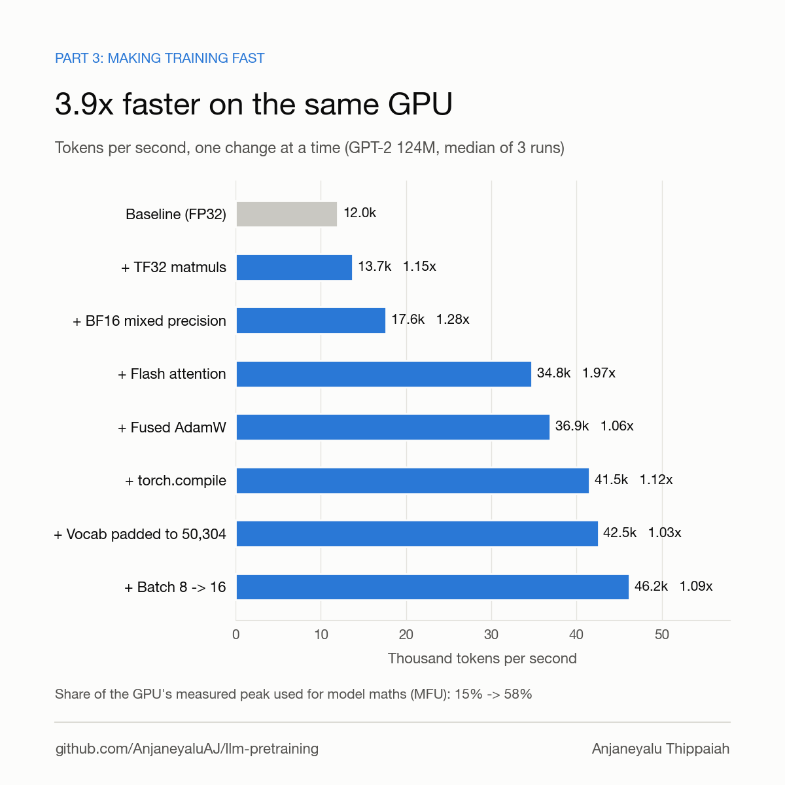
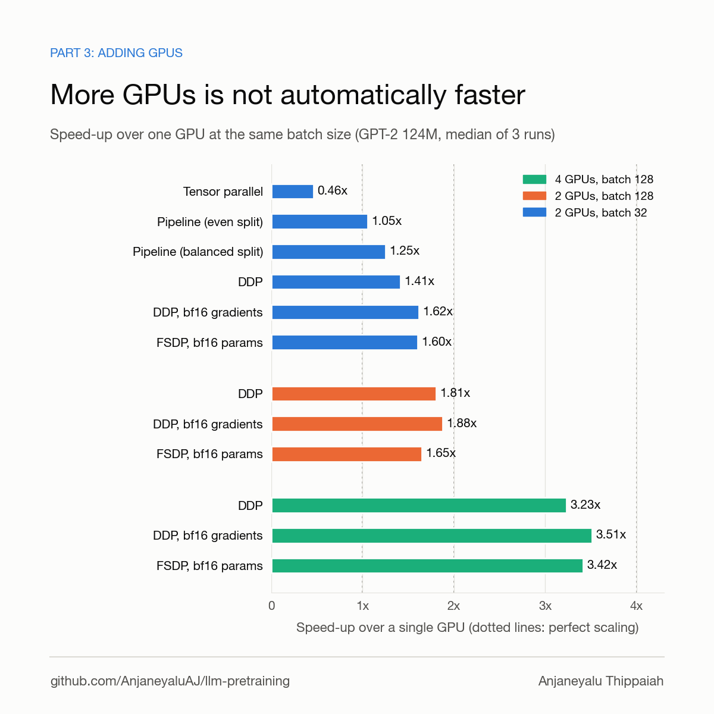
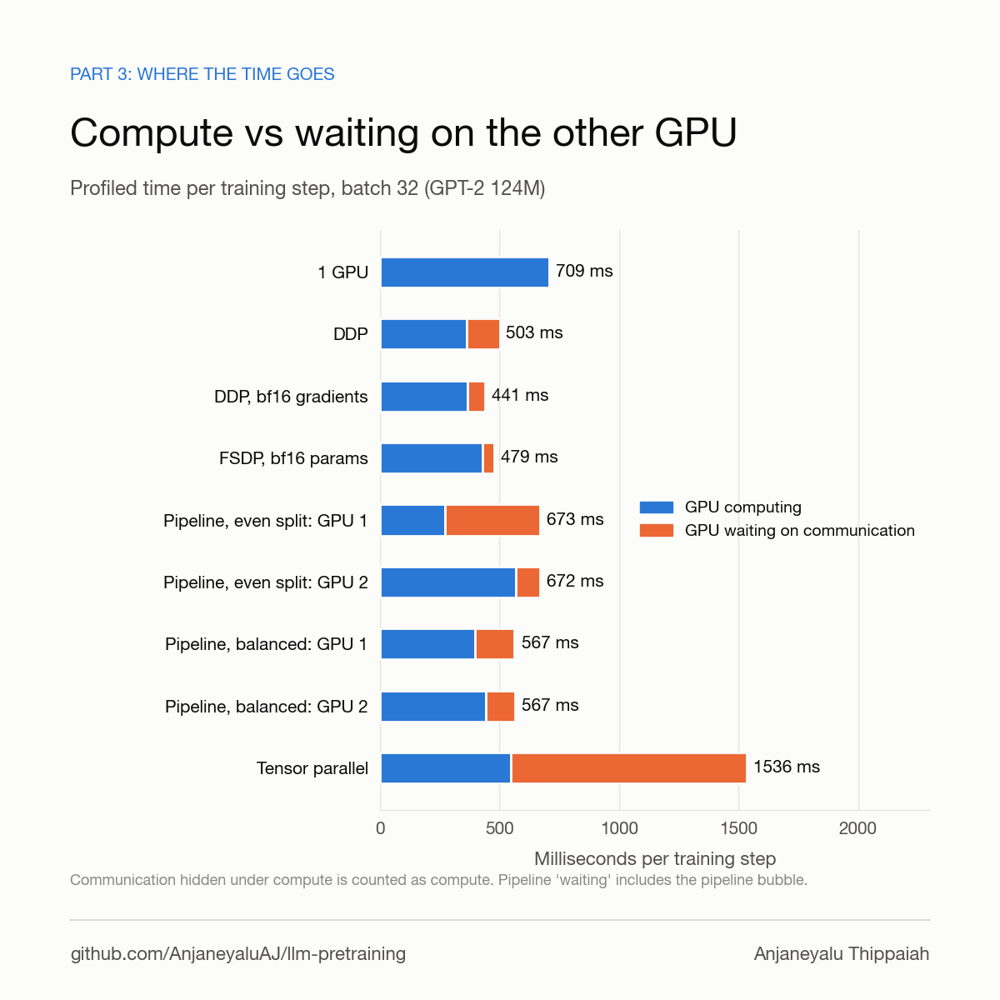

# Step 2: making training fast, and splitting it across GPUs

**Author:** Anjaneyalu Thippaiah

Step 1 ([results/gpt2_124m_fineweb](../gpt2_124m_fineweb/README.md)) trained GPT-2 124M from
scratch and beat OpenAI's GPT-2 on HellaSwag. This step measures **how** that training gets
fast, and what happens when the same work is split across GPUs in different ways:

1. **One GPU**: what each standard speed-up is worth (TF32, bf16, flash attention, fused
   AdamW, `torch.compile`, vocab padding, batch size), measured both by adding them one at a
   time and by removing them one at a time.
2. **Several GPUs**: DDP, FSDP2, tensor parallel (with and without sequence parallel) and
   pipeline parallel (1F1B, GPipe, interleaved, uneven splits), all doing exactly the same
   math per optimizer step. The results are explained with a communication model checked
   against the profiler, and every strategy is checked to compute the same gradients as one GPU.
3. **Memory**: which model sizes fit with which strategy on a 24 GB GPU.

Every throughput number is the median of 3 interleaved repeats unless marked otherwise. Every
number in this file is in [`summary.json`](summary.json) or in the raw files listed under
[Files](#files).



---

## Contents

1. [Results at a glance](#results-at-a-glance)
2. [Setup and measurement protocol](#setup-and-measurement-protocol)
3. [What was added to the code](#what-was-added-to-the-code)
4. [Reproduce](#reproduce)
5. [Tool reference](#tool-reference)
6. [Results: one GPU](#results-one-gpu)
7. [Results: several GPUs](#results-several-gpus)
8. [Why: communication model and profiler](#why-communication-model-and-profiler)
9. [Results: memory limits](#results-memory-limits)
10. [Observation: DDP communication did not overlap on this software stack](#observation-ddp-communication-did-not-overlap-on-this-software-stack)
11. [Correctness: every strategy computes the same gradients](#correctness-every-strategy-computes-the-same-gradients)
12. [What I would do with this](#what-i-would-do-with-this)
13. [Limitations and open questions](#limitations-and-open-questions)
14. [Troubleshooting](#troubleshooting)
15. [Files](#files)
16. [Credits](#credits)

---

## Results at a glance

**One GPU, GPT-2 124M:** 11,981 -> 46,222 tokens/s (**3.86x**), MFU 15.1% -> 58.5%.

| removed from the full config | throughput lost |
|---|---:|
| bf16 autocast | -49.6% |
| flash attention (SDPA) | -22.6% |
| `torch.compile` | -9.1% |
| fused AdamW | -6.7% |
| vocab padding 50257 -> 50304 | -2.5% |
| TF32 | 0.0% |

**Several GPUs, same global batch, speed-up over one GPU:**

| strategy | 2 GPUs, batch 32 | 2 GPUs, batch 128 | 4 GPUs, batch 128 |
|---|---:|---:|---:|
| DDP | 1.41x | 1.81x | 3.23x |
| DDP, bf16 gradient all-reduce | **1.62x** | **1.88x** | **3.51x** |
| FSDP2, bf16 params | 1.49x (1.60x without reshard) | 1.65x | 3.42x |
| Pipeline 1F1B, even / balanced split | 1.05x / 1.25x | | |
| Tensor parallel / + sequence parallel | 0.46x / 0.40x | | |



The main lessons, each explained below:

- On a PCIe-only machine (about 3.6 GB/s between GPUs), **the number of bytes communicated
  decides the ranking**. Halving them (bf16 gradients) helped more than any other knob. At
  batch 32 on 2 GPUs, DDP with bf16 gradients and FSDP2 without reshard are tied (1.62x vs
  1.60x, within run-to-run spread).
- **Tensor parallel** puts communication inside every layer, on the critical path. Here it
  is about 2x **slower** than one GPU. How it is wired matters too: a first version, in which
  Q, K and V each reduced their own input gradient, moved 67% more data and ran at 0.33x.
- **Pipeline parallel** lost mostly to **stage imbalance**, not bandwidth. The last stage
  also carries the 768 x 50304 output layer. Moving layers to the first stage lifted it from
  1.05x to 1.25x.
- **DDP's gradient communication did not overlap with compute** on this software stack
  (0 ms hidden according to the profiler). It does overlap on an older stack on the same
  machine. The cause is not isolated yet, and the gain from overlap here is small anyway (see
  [the observation section](#observation-ddp-communication-did-not-overlap-on-this-software-stack)).
- **GPT-2 1.5B** cannot train on one 24 GB GPU or with DDP at any batch size: weights plus
  AdamW state alone are about 25 GB. Only FSDP fits it.
- **Correctness**: in fp32 every strategy matches the single-GPU gradients to 4e-8 - 7e-7;
  in bf16 every strategy is within the noise floor, except the two configs that round on
  purpose.

---

## Setup and measurement protocol

| | |
|---|---|
| Hardware | AWS g5.12xlarge: 4x NVIDIA A10G 24 GB, 48 vCPU. GPUs connect only through PCIe and the host bridge (`nvidia-smi topo -m`: `PHB`). No NVLink, no GPU peer-to-peer; NCCL uses its shared-memory transport (`SHM/direct`). |
| Software | torch 2.15.0+cu132, CUDA 13.2, NCCL 2.30.7, Triton 3.9.0, NVIDIA driver 595.91.07, Ubuntu 26.04, kernel 7.0.0-1014-aws ([`env.txt`](env.txt)) |
| Model | GPT-2 124M (`gpt2-124m` preset): 12 layers, 768 wide, 12 heads, context 1024, tied embeddings, no dropout. `gpt2-774m` and `gpt2-1558m` for the memory tests. |
| Data | 300,000 FineWeb-Edu documents (`sample-10BT`): 305,193,256 train tokens, GPT-2 tokenizer. Real batches, not random tokens. |
| Optimizer | AdamW, lr 6e-4, betas 0.9 / 0.95, weight decay 0.1, gradient clipping at 1.0 |
| Throughput | `train.py` runs (the ladder): median tokens/s over the log intervals after step 20 of an 80-step run. `bench_parallel.py` runs: median CUDA-synchronized step time over steps 31-80. The first steps hold `torch.compile` and allocator warm-up, so they are excluded. |
| MFU | FLOPs per token = 6N + 12·L·d·T (N parameters, L layers, d width, T context; the second term is attention), times tokens/s, divided by 68 TFLOP/s per GPU. 68 TFLOP/s is the **measured** bf16 dense-matmul peak of one A10G (below), not the 125 TFLOP/s datasheet number. Against the datasheet, every MFU here would be 0.54x as large. |
| Repeats | 3 repeats, **interleaved**: every config once, then every config again, then a third time. Slow drift (temperature, clocks) therefore spreads over all configs instead of landing on one. The spread between the fastest and slowest repeat is under 0.5% for 33 of 40 repeated configs and at most 1.4% (FSDP2 bf16 params). Differences smaller than about 1.5% are therefore treated as ties, for example DDP with bf16 gradients (1.62x) vs FSDP2 without reshard (1.60x). |
| Clocks | `nvidia-smi` logged every GPU every second for the whole campaign ([`gpu_clocks.csv.gz`](gpu_clocks.csv.gz)). While busy: median 1710 MHz (the maximum), minimum 1425 MHz, peak temperature 60 C, power limit 300 W. The tight repeat spread shows that the dips did not move any result. |
| Memory | peak `torch.cuda.max_memory_allocated` per GPU. Runs use `PYTORCH_CUDA_ALLOC_CONF=expandable_segments:True`. |

Measured hardware baselines ([`hw/`](hw/), `scripts/bench_hw.py`):

| | measured |
|---|---|
| bf16 dense matmul, per GPU | 67.7 / 68.3 / 68.0 / 68.1 TFLOP/s |
| TF32 dense matmul | 34.0 TFLOP/s |
| fp32 dense matmul | 23.5 TFLOP/s |
| NCCL all-reduce bus bandwidth, 2 / 4 GPUs (messages >= 64 MB) | 3.65 / 4.95 GB/s |
| NCCL all-gather bus bandwidth, 2 / 4 GPUs | 3.06 / 4.10 GB/s |
| NCCL reduce-scatter bus bandwidth, 2 / 4 GPUs | 3.00 / 4.92 GB/s |
| send/recv GPU to GPU | 4.59 GB/s |
| all-reduce bus bandwidth at 1 MB / 8 MB messages, 2 GPUs | 3.35 / 3.73 GB/s |

Bus bandwidth follows the nccl-tests convention (all-reduce: algorithm bandwidth x 2(n-1)/n;
all-gather and reduce-scatter: x (n-1)/n), so numbers compare across GPU counts. Small
messages lose little bandwidth on this link. For scale: NVLink on an A100 or H100 node gives
hundreds of GB/s, so this interconnect is about two orders of magnitude slower. **Read every
multi-GPU result with that in mind.**

---

## What was added to the code

Library and `train.py` (small, backwards-compatible changes; defaults keep step 1's behaviour):

| change | where | why |
|---|---|---|
| `model.attn_impl: sdpa \| manual` | `llmtrain/models/attention.py` (new), `gpt.py`, `llama.py` | `manual` is the textbook attention (scores, causal mask, softmax, weighted sum, written out), so the ladder can switch flash attention off. Matches `sdpa` to about 4e-6 in fp32. |
| `train.tf32: true` | `llmtrain/config.py`, `train.py` | TF32 used to be always on |
| `train.fused_adamw: true` | `llmtrain/config.py`, `llmtrain/optim.py` | fused AdamW used to be always on |
| attention output reshaped with `reshape(b, t, -1)` | `gpt.py`, `llama.py` | under tensor parallelism each GPU holds only some heads, so the width is not `emb_dim` |
| `mem X GB` in the training log, `peak_mem_gb` in `metrics.jsonl` | `train.py` | peak memory per GPU |
| run line shows `attn`, `tf32`, `fused AdamW` | `train.py` | the log states which speed-ups are on |

New scripts:

| script | what it does |
|---|---|
| `scripts/bench_hw.py` | measured matmul peak (fp32 / TF32 / bf16) and NCCL bandwidth (all-reduce, all-gather, reduce-scatter, send/recv) |
| `scripts/bench_parallel.py` | trains GPT-2 with one of `single`, `ddp`, `fsdp`, `tp`, `pp` and their tuning knobs; reports throughput, MFU, memory; optionally profiles or dumps gradients |
| `scripts/gradcheck.sh` | one-step gradient dump of every strategy, then `compare_grads.py` |
| `scripts/compare_grads.py` | compares each strategy's gradients with the single-GPU gradients |
| `scripts/run_step2.sh` | the whole measurement campaign behind this write-up |
| `scripts/analyze_step2.py` | turns the campaign output into the tables here and `summary.json` |
| `scripts/repro/then_blocks_overlap.py`, `scripts/repro/ddp_overlap_toy.py` | minimal scripts for the DDP overlap observation |
| `results/step2_performance/charts/make_step2_charts.py` | the three charts |

---

## Reproduce

On a machine with 2-4 GPUs and the repo's `.venv` (see the main [README](../../README.md#setup)).
The campaign takes about 3.5 hours on 4x A10G.

```bash
cd ~/AJ/llm-pretraining
source .venv/bin/activate
export PYTORCH_CUDA_ALLOC_CONF=expandable_segments:True

# 1. data: 300k FineWeb-Edu documents, ~305M tokens (about 1 minute)
python prepare_data.py --hf_dataset HuggingFaceFW/fineweb-edu --hf_config sample-10BT --max_docs 300000 \
    --output_dir /mnt/nvme/tok/fineweb-edu-300k --val_fraction 0.01 --num_proc 44

# 2. hardware baselines (a few minutes)
mkdir -p /mnt/nvme/runs/hw
python scripts/bench_hw.py matmul > /mnt/nvme/runs/hw/matmul.jsonl
CUDA_VISIBLE_DEVICES=0,1 torchrun --standalone --nproc_per_node=2 scripts/bench_hw.py comm > /mnt/nvme/runs/hw/comm_2.jsonl
torchrun --standalone --nproc_per_node=4 scripts/bench_hw.py comm > /mnt/nvme/runs/hw/comm_4.jsonl

# 3. gradient equivalence, fp32 and bf16 (about 15 minutes each)
bash scripts/gradcheck.sh fp32
bash scripts/gradcheck.sh bf16

# 4. the full campaign in tmux (ladder + leave-one-out, parallel strategies, memory limits, profiles)
tmux new -s step2 'bash scripts/run_step2.sh 2>&1 | tee /mnt/nvme/logs/step2.log'

# 5. tables, summary.json and charts
python scripts/analyze_step2.py /mnt/nvme/runs/step2 --hw /mnt/nvme/runs/hw --out results/step2_performance
python results/step2_performance/charts/make_step2_charts.py results/step2_performance/summary.json results/step2_performance/charts
```

Two groups of runs were added after the main campaign: DDP with bf16 gradients, and tensor
parallel with a shared input (`--tp_shared_input`). `run_step2.sh` and `gradcheck.sh` now
include them; the published numbers for those runs come from `extra.jsonl` and
`extra_profile.jsonl`, which `analyze_step2.py` reads together with the main files.

The PyTorch 2.8 comparison in the [observation section](#observation-ddp-communication-did-not-overlap-on-this-software-stack)
uses a second environment on the same machine:

```bash
~/.local/bin/uv venv -p 3.12 /mnt/nvme/venv28
source /mnt/nvme/venv28/bin/activate
~/.local/bin/uv pip install "torch==2.8.0" numpy --index-url https://download.pytorch.org/whl/cu128
~/.local/bin/uv pip install pyyaml tiktoken tqdm
torchrun --standalone --nproc_per_node=2 scripts/repro/then_blocks_overlap.py
torchrun --standalone --nproc_per_node=2 scripts/repro/ddp_overlap_toy.py
C="--global_batch 32 --micro_batch 16 --steps 80 --skip 30 --out /mnt/nvme/runs/torch28/parallel.jsonl"
python scripts/bench_parallel.py --strategy single $C --label single_t28
torchrun --standalone --nproc_per_node=2 scripts/bench_parallel.py --strategy ddp $C --label ddp_t28
```

---

## Tool reference

### `scripts/bench_hw.py`

```bash
python scripts/bench_hw.py matmul                                   # every visible GPU, one at a time
torchrun --standalone --nproc_per_node=2 scripts/bench_hw.py comm   # NCCL between 2 GPUs
```

| mode | measures | output (JSON lines on stdout) |
|---|---|---|
| `matmul` | square matmuls of several sizes in fp32, TF32 and bf16; the best TFLOP/s per dtype | one line per GPU: `{"gpu", "name", "fp32_tflops", "tf32_tflops", "bf16_tflops"}` |
| `comm` | `all_reduce`, `all_gather_into_tensor`, `reduce_scatter_tensor` and `send`/`recv`, messages from 1 MB to 512 MB | one line per message size: `{"world", "mb", "all_reduce_busbw_gbs", "all_gather_busbw_gbs", "reduce_scatter_busbw_gbs", "send_recv_gbs"}`, then the NCCL version |

`analyze_step2.py` takes the mean bus bandwidth over messages of 64 MB and larger.

### `scripts/bench_parallel.py`

Trains GPT-2 for `--steps` optimizer steps with one strategy and reports steady-state speed.
Every strategy uses bf16 autocast, SDPA attention, fused AdamW, `torch.compile` per
transformer block, gradient clipping at 1.0 and the **same global batch**, so they all do
the same math per step.

```bash
python scripts/bench_parallel.py --strategy single                                  # 1-GPU reference
torchrun --standalone --nproc_per_node=2 scripts/bench_parallel.py --strategy ddp --ddp_bf16_grads
torchrun --standalone --nproc_per_node=2 scripts/bench_parallel.py --strategy fsdp --fsdp_bf16 --fsdp_no_reshard
torchrun --standalone --nproc_per_node=2 scripts/bench_parallel.py --strategy tp --tp_shared_input
torchrun --standalone --nproc_per_node=2 scripts/bench_parallel.py --strategy pp --microbatches 8 --pp_split 9
```

How each strategy is built:

| strategy | implementation |
|---|---|
| `single` | one GPU; gradient accumulation over `global_batch / micro_batch` micro-batches |
| `ddp` | `DistributedDataParallel`; each GPU runs `global_batch / (GPUs x micro_batch)` micro-batches, with `no_sync()` on all but the last, so gradients are all-reduced **once per step** |
| `fsdp` | FSDP2: `fully_shard` on every transformer block, then on the root model. Parameters, gradients and AdamW state are sharded. `set_requires_gradient_sync(False)` on all but the last micro-batch, so gradients are reduce-scattered **once per step**. |
| `tp` | Megatron-style tensor parallelism with DTensor: `W_query`, `W_key`, `W_value` and the first MLP layer are `ColwiseParallel`; `out_proj` and the second MLP layer are `RowwiseParallel`. Each GPU holds `n_heads / GPUs` heads. Both GPUs see the whole batch. |
| `tp --tp_shared_input` | the attention block and the MLP receive their input as one replicated DTensor (`PrepareModuleInput(..., use_local_output=False)`). The three column-parallel projections then share one input, so backward sums their input gradients and reduces once per sub-layer. Without it each projection receives a plain tensor and all-reduces its own input gradient. |
| `tp --tp_sp` | adds sequence parallelism: the layer norms and the residual stream are sharded along the sequence (`SequenceParallel`, `Shard(1)` layouts), turning each all-reduce into a reduce-scatter plus an all-gather. Combine with `--tp_shared_input`; without it the backward still does the per-projection all-reduces on top. |
| `pp` | `torch.distributed.pipelining`: blocks split into stages (first stage also holds the embeddings, last stage the final norm and output layer); the global batch is split into `--microbatches`. The tied embedding / output weight lives on both end stages, and its two gradient contributions are summed with an all-reduce after each step. |

Options:

| option | default | meaning |
|---|---|---|
| `--strategy` | required | `single`, `ddp`, `fsdp`, `tp` or `pp` (`single` runs with `python`, the others with `torchrun` and 2+ GPUs) |
| `--preset` | `gpt2-124m` | any model preset |
| `--vocab_size` | `50304` | output vocabulary (50257 padded to a multiple of 128) |
| `--data` | `/mnt/nvme/tok/fineweb-edu-300k` | output of `prepare_data.py` |
| `--global_batch` | `32` | sequences per optimizer step, over all GPUs |
| `--micro_batch` | `16` | sequences per forward pass (not used by `pp`) |
| `--precision` | `bf16` | `bf16` autocast, or strict `fp32` (TF32 off) |
| `--no_compile` | off | skip `torch.compile` |
| `--act_ckpt` | off | activation checkpointing of every transformer block |
| `--ddp_bf16_grads` | off | DDP: all-reduce gradients in bf16 (`bf16_compress_hook`) |
| `--ddp_tuned` | off | DDP: 100 MB buckets and `gradient_as_bucket_view` |
| `--fsdp_bf16` | off | FSDP: gather parameters in bf16; gradients still reduced in fp32 |
| `--fsdp_no_reshard` | off | FSDP: keep parameters gathered after forward (one all-gather per step instead of two) |
| `--tp_shared_input` | off | TP: one shared DTensor input per sub-layer (see above) |
| `--tp_sp` | off | tensor parallel plus sequence parallel |
| `--microbatches` | `8` | pipeline micro-batches per step |
| `--pp_schedule` | `1f1b` | `1f1b` or `gpipe` |
| `--pp_split` | half | transformer blocks on the first of 2 stages (e.g. `9` = 9/3) |
| `--pp_virtual` | `1` | stages per GPU; `2` = interleaved 1F1B |
| `--steps`, `--skip` | `60`, `20` | optimizer steps; leading steps excluded from timing |
| `--lr` | `6e-4` | |
| `--peak_flops` | `68e12` | per-GPU peak for MFU |
| `--profile DIR` | off | trace 3 more steps with `torch.profiler`, save one Chrome trace per GPU and print the time breakdown |
| `--check_grads DIR` | off | one forward/backward on a fixed batch from the same initial weights; save every parameter's full gradient per GPU and exit |
| `--label` | strategy | name of the run in the output |
| `--out FILE` | none | append the result to this JSON-lines file |

Console output:

```
ddp_bf16grads          2 GPU |    74,964 tok/s | MFU  47.4% | step   437.0 ms | mem/GPU 19.3/19.3 GB | loss 7.017
   rank0: compute 368 ms | comm overlapped 0 | comm exposed 70 | idle 4 | wall 441      (with --profile)
```

JSON record fields: `label`, `strategy`, `gpus`, `preset`, `params_m`, `global_batch`,
`micro_batch`, `accum`, `microbatches`, `options`, `compile`, `step_s`, `step_s_min_max`,
`tok_per_s`, `mfu`, `peak_flops`, `peak_mem_gb`, `mem_alloc_per_gpu_gb`,
`mem_reserved_per_gpu_gb`, `final_loss`, `steps`, `skip`, `breakdown_per_rank`, `torch`.

**How the profiler breakdown is computed.** From each GPU's trace, kernels with `nccl` in
the name are communication and all other kernels, copies and memsets are compute. Intervals
are merged, then: hidden communication = time where communication and compute run at the
same time; exposed communication = communication time minus hidden; idle = wall time
minus busy time. Wall time is per step, averaged over the 3 traced steps. One caution: an
NCCL kernel runs from launch until the transfer completes, so it also counts time spent
**waiting for the other GPU** to reach the same collective. With unbalanced work (the
pipeline runs) "exposed communication" is mostly waiting, not transfer.

### `scripts/gradcheck.sh` and `scripts/compare_grads.py`

```bash
bash scripts/gradcheck.sh fp32      # or bf16; results in /mnt/nvme/runs/gradcheck/<precision>/
python scripts/compare_grads.py /mnt/nvme/runs/gradcheck/bf16 --ref single --json summary.json
```

`gradcheck.sh` runs `bench_parallel.py --check_grads` for every strategy and variant in the
[Correctness](#correctness-every-strategy-computes-the-same-gradients) table, all at global
batch 32 and micro-batch 8. The same initial weights (seed 123) and the same batch are used
every time. Sharded (FSDP) and DTensor (TP) gradients are gathered to full tensors before
saving; pipeline stages each save their own parameters and are merged.

`compare_grads.py` reports, per run, the relative L2 error of the whole gradient vector
against the reference, the worst per-tensor relative error, and the cosine similarity.

### `scripts/run_step2.sh`

The campaign behind this file. Environment variables: `R` (output dir, default
`/mnt/nvme/runs/step2`), `REPS` (default 3).

| part | what runs | output |
|---|---|---|
| environment | git commit and status, library versions, GPU list | `env.txt` |
| clocks | `nvidia-smi` every second for the whole campaign | `gpu_clocks.csv` |
| 1. ladder + leave-one-out | 14 `train.py` runs on GPU 0, 80 steps each, x `REPS` | `ladder/rep<N>/<name>/metrics.jsonl` |
| 2. parallel strategies | every multi-GPU config on 1, 2 and 4 GPUs, 80 steps (30 skipped), x `REPS` | `parallel.jsonl` |
| 3. memory limits | 774M and 1.5B, micro-batch 1 and 4, with and without activation checkpointing: single, DDP, FSDP2 on 2 and on 4 GPUs. Short runs (12 steps); out-of-memory is a result. | `memory.jsonl` |
| 4. profiles | the main configs, 40 steps (20 skipped) + 3 traced | `profile.jsonl`, `traces/` |

The ladder uses `train.py` with `configs/gpt2_124m_fineweb_a10g.yaml` and `--set`
overrides, so it measures the real training script, data loader and logging included.

### `scripts/analyze_step2.py`

```bash
python scripts/analyze_step2.py /mnt/nvme/runs/step2 --hw /mnt/nvme/runs/hw --out results/step2_performance
```

Prints every table in this file and writes `summary.json` with the sections `hardware`,
`ladder`, `parallel`, `comm_model`, `profiles`, `memory_fits` and `clocks`. Runs that
appear more than once are summarized as median, min and max. Missing files are skipped,
so it works on a partial campaign.

---

## Results: one GPU

### The ladder

Each row adds one change to the row above. GPT-2 124M, micro-batch 8 x 1024 tokens, 1 GPU.

| change | tokens/s [min, max] | vs previous | vs baseline | MFU | peak memory |
|---|---:|---:|---:|---:|---:|
| baseline: fp32, manual attention, unfused AdamW, eager, vocab 50257 | 11,981 [11,979, 11,999] | | 1.00x | 15.1% | 17.8 GB |
| + TF32 matmuls | 13,728 [13,726, 13,728] | 1.15x | 1.15x | 17.4% | 17.8 GB |
| + bf16 autocast | 17,640 [17,639, 17,642] | 1.28x | 1.47x | 22.3% | 17.8 GB |
| + flash attention (SDPA) | 34,766 [34,760, 34,768] | 1.97x | 2.90x | 44.0% | 10.6 GB |
| + fused AdamW | 36,922 [36,916, 36,924] | 1.06x | 3.08x | 46.7% | 10.6 GB |
| + `torch.compile` | 41,502 [41,496, 41,504] | 1.12x | 3.46x | 52.5% | 10.3 GB |
| + vocab padded 50257 -> 50304 | 42,549 [42,546, 42,560] | 1.03x | 3.55x | 53.8% | 10.3 GB |
| + micro-batch 8 -> 16 | 46,222 [46,218, 46,225] | 1.09x | **3.86x** | **58.5%** | 18.8 GB |

### Leave-one-out

A ladder gives each change credit relative to the changes made before it, so the order of
the rows affects the numbers. Leave-one-out starts from the full configuration (the
vocab-padded row, micro-batch 8) and removes one change at a time:

| removed | tokens/s | change |
|---|---:|---:|
| nothing (full config) | 42,549 | |
| bf16 autocast | 21,439 | -49.6% |
| flash attention | 32,912 | -22.6% |
| `torch.compile` | 38,661 | -9.1% |
| fused AdamW | 39,704 | -6.7% |
| vocab padding | 41,503 | -2.5% |
| TF32 | 42,545 | 0.0% |

### Reading the two tables together

- **TF32: +15% on the ladder, 0% at the end.** With bf16 autocast the matmuls already run
  in bf16, so TF32 only affects the few operations left in fp32. It matters only for fp32
  training.
- **bf16** is the biggest single item: tensor-core bf16 matmuls run at 2x the TF32 rate
  (68 vs 34 TFLOP/s measured), and activations take half the memory traffic.
- **Flash attention: 1.97x on the ladder, -22.6% leave-one-out.** In eager mode, manual
  attention writes the 1024 x 1024 score matrix of every head to GPU memory and reads it
  back several times (mask, softmax, weighted sum). That is slow, and it accounts for the
  memory difference (17.8 vs 10.6 GB). Flash attention computes the same result in on-chip
  tiles and never stores the full matrix. With `torch.compile` on, Inductor can fuse the
  manual mask / scale / softmax chain. That is the likely reason removing SDPA costs less in
  the full configuration, but I have not profiled that case separately.
- **Fused AdamW** updates all parameters in a few kernels instead of several kernels per
  parameter tensor: +6-7%.
- **`torch.compile`** fuses the remaining elementwise operations (GELU, layer norm, residual
  adds): +9-12%.
- **Vocab padding** makes the output layer's dimension a multiple of 128 (50304 = 128 x 393),
  which tensor-core matmul kernels tile cleanly. It adds 47 output tokens the data never uses
  (+0.1% FLOPs) and gains 2.5-3%.
- **Micro-batch 16 vs 8**: bigger kernels keep the GPU busier, +9%, at the cost of peak
  memory going from 10.3 to 18.8 GB. On a 24 GB GPU, 16 is the ceiling.

The `loss` column in `summary.json` comes from 80-step speed runs and is **not** a quality
comparison: the batch-16 run sees twice the tokens per step, and the vocab-50257 run has a
different output layer. Numerical equivalence is shown separately in
[Correctness](#correctness-every-strategy-computes-the-same-gradients).

---

## Results: several GPUs

Every run uses the same **global** batch per optimizer step, so every strategy does the
same math. Speed-up is relative to one GPU at the same global batch; scaling efficiency is
speed-up divided by the number of GPUs.

### Global batch 32 (32 x 1024 tokens per step), 2 GPUs

| strategy | tokens/s [min, max] | speed-up | efficiency | MFU | memory per GPU |
|---|---:|---:|---:|---:|---|
| 1 GPU (2 x micro-batch 16) | 46,340 [46,339, 46,341] | 1.00x | | 58.6% | 19.0 GB |
| DDP | 65,474 [65,312, 65,688] | 1.41x | 71% | 41.4% | 19.3 GB |
| DDP, 100 MB buckets + bucket views | 65,794 [65,752, 65,835] | 1.42x | 71% | 41.6% | 19.3 GB |
| **DDP, bf16 gradient all-reduce** | **74,964** [74,550, 74,992] | **1.62x** | 81% | 47.4% | 19.3 GB |
| FSDP2, fp32 | 59,306 [59,141, 59,468] | 1.28x | 64% | 37.5% | 17.8 GB |
| FSDP2, bf16 params | 69,049 [68,159, 69,105] | 1.49x | 75% | 43.7% | 17.2 GB |
| FSDP2, bf16 params, no reshard after forward | 74,209 [74,027, 74,416] | 1.60x | 80% | 46.9% | 17.4 GB |
| tensor parallel, per-projection input reduction | 15,161 [15,151, 15,184] | 0.33x | 16% | 9.6% | 16.4 GB |
| **tensor parallel, shared input** | **21,409** [21,372, 21,560] | **0.46x** | 23% | 13.5% | 16.4 GB |
| tensor + sequence parallel, per-projection | 12,406 [12,392, 12,423] | 0.27x | 13% | 7.8% | 16.0 GB |
| tensor + sequence parallel, shared input | 18,647 [18,627, 18,796] | 0.40x | 20% | 11.8% | 16.0 GB |
| pipeline 1F1B, 6/6, 4 micro-batches | 49,708 [49,666, 49,773] | 1.07x | 54% | 31.4% | 4.3 / 11.3 GB |
| pipeline 1F1B, 6/6, 8 micro-batches | 48,827 [48,811, 48,988] | 1.05x | 53% | 30.9% | 3.0 / 8.2 GB |
| pipeline 1F1B, 6/6, 16 micro-batches | 46,513 [46,505, 46,578] | 1.00x | 50% | 29.4% | 2.3 / 8.2 GB |
| pipeline 1F1B, 6/6, 32 micro-batches | 40,261 [40,242, 40,292] | 0.87x | 43% | 25.5% | 2.0 / 8.2 GB |
| pipeline GPipe, 6/6, 8 micro-batches | 49,662 [49,617, 49,700] | 1.07x | 54% | 31.4% | 7.1 / 18.7 GB |
| pipeline 1F1B, 7/5, 8 micro-batches | 51,521 [51,504, 51,554] | 1.11x | 56% | 32.6% | 3.3 / 8.2 GB |
| pipeline 1F1B, 8/4, 8 micro-batches | 54,591 [54,572, 54,737] | 1.18x | 59% | 34.5% | 3.6 / 8.1 GB |
| **pipeline 1F1B, 9/3, 8 micro-batches** | **58,028** [57,889, 58,125] | **1.25x** | 63% | 36.7% | 4.0 / 8.0 GB |
| pipeline interleaved 1F1B (2 chunks per GPU), 8 micro-batches | 47,361 [47,347, 47,366] | 1.02x | 51% | 29.9% | 3.5 / 8.7 GB |

### Global batch 128 (gradient accumulation, synchronized once per step)

| strategy | GPUs | tokens/s [min, max] | speed-up | efficiency | memory per GPU |
|---|---:|---:|---:|---:|---|
| 1 GPU (8 x micro-batch 16) | 1 | 46,702 [46,701, 46,703] | 1.00x | | 19.0 GB |
| DDP | 2 | 84,358 [84,344, 84,371] | 1.81x | 90% | 19.8 GB |
| DDP, 100 MB buckets + bucket views | 2 | 84,454 [84,366, 84,460] | 1.81x | 90% | 19.8 GB |
| DDP, bf16 gradients | 2 | 87,749 (1 run) | 1.88x | 94% | 19.8 GB |
| FSDP2, bf16 params | 2 | 77,011 [76,987, 77,041] | 1.65x | 82% | 17.7 GB |
| DDP | 4 | 151,050 [150,850, 151,450] | 3.23x | 81% | 19.8 GB |
| DDP, bf16 gradients | 4 | 163,934 (1 run) | 3.51x | 88% | 19.8 GB |
| FSDP2, bf16 params | 4 | 159,535 [159,237, 159,830] | 3.42x | 85% | 17.3 GB |

The bigger DDP buckets changed nothing measurable (1.42x vs 1.41x). `static_graph=True`,
the other usual DDP knob, could not be tested: combined with `no_sync()` accumulation it
fails an internal assertion in torch 2.15.

---

## Why: communication model and profiler

For each strategy I predicted the communication time per step: the bytes the strategy has
to move, divided by the measured NCCL bandwidth, assuming no overlap with compute. I
compared it with the **measured overhead**, which is step time minus (one-GPU step time /
number of GPUs), and with the profiler breakdown.

How the bytes are counted (N = 124.4M parameters):

| strategy | bytes per step |
|---|---|
| DDP | one all-reduce of all gradients: 4N bytes (fp32) or 2N (bf16) |
| FSDP2 | per micro-batch, 1 or 2 parameter all-gathers (forward, plus backward when resharding), 2N bytes each in bf16 or 4N in fp32; plus one reduce-scatter of 4N bytes of fp32 gradients |
| tensor parallel | per layer per micro-batch: forward all-reduces the outputs of `out_proj` and of the second MLP layer (bf16, 16 x 1024 x 768 x 2 bytes = 25 MB each); backward all-reduces the input gradients of the column-parallel layers, which are **fp32** (50 MB each) because their input, the LayerNorm output, is fp32 under autocast. That is 4 backward all-reduces per layer with per-projection reduction (Q, K, V and the first MLP layer each reduce their own), or 2 with a shared input. |
| pipeline | per micro-batch, the fp32 activations forward and their gradients backward across the stage boundary, plus the bubble: (one-GPU step / n) x (n-1)/m |

The tensor-parallel byte count was **corrected after inspecting the trace**. The first
version of the model assumed 4 bf16 all-reduces per layer and predicted 662 ms against
1,808 ms measured. Counting the collectives in the profiler trace (48 bf16 all-reduces of
6.8 ms and 96 fp32 all-reduces of 13.3 ms per step, both at the measured bandwidth) gave the
corrected model below, which matches.



| run (2 GPUs, batch 32) | predicted | measured overhead | profiler: compute / hidden comm / exposed comm / idle (ms) |
|---|---:|---:|---|
| 1 GPU | | | 706 / 0 / 0 / 2 (wall 709) |
| DDP (fp32 gradients, 497 MB) | 136 ms | 147 ms | 363 / **0** / 138 / 2 |
| DDP, bf16 gradients (249 MB) | 68 ms | 84 ms | 368 / 0 / 70 / 4 |
| FSDP2, fp32 | 246 ms | 199 ms | 485 / 229 / 71 / 3 |
| FSDP2, bf16 params | 164 ms | 121 ms | 428 / 146 / 48 / 3 |
| FSDP2, bf16 params, no reshard | 124 ms | 88 ms | (not profiled) |
| tensor parallel, per-projection | 1,655 ms | 1,808 ms | 550 / 0 / 1,611 / 4 |
| tensor parallel, shared input | 993 ms | 1,177 ms | 547 / 0 / 985 / 4 |
| tensor + sequence parallel, per-projection | (not modeled) | 2,288 ms | 546 / 0 / 2,101 / 4 |
| tensor + sequence parallel, shared input | (not modeled) | 1,404 ms | 542 / 0 / 1,209 / 4 |
| pipeline 1F1B 6/6, m8 | 88 ms | 318 ms | GPU 1: 272 / 3 / 396 / 4; GPU 2: 568 / 0 / 100 / 4 |
| pipeline 1F1B 9/3, m8 | 88 ms | 211 ms | GPU 1: 399 / 3 / 162 / 6; GPU 2: 441 / 0 / 123 / 3 |

| run (batch 128) | predicted | measured overhead | profiler |
|---|---:|---:|---|
| DDP, 2 GPUs | 136 ms | 150 ms | 1,415 / 0 / 135 / 4 (wall 1,554) |
| DDP, 4 GPUs | 151 ms | 166 ms | |
| DDP bf16 gradients, 2 / 4 GPUs | 68 / 75 ms | 90 / 98 ms | |
| FSDP2 bf16 params, 2 GPUs | 408 ms | 299 ms | |
| FSDP2 bf16 params, 4 GPUs | 258 ms | 120 ms | |

What the tables show:

- **DDP: prediction and measurement agree, and nothing overlaps.** 136 ms predicted, 147 ms
  measured, 138 ms exposed and 0 ms hidden in the profiler. DDP is designed to overlap the
  gradient all-reduce with the rest of backward. Why it does not here is covered in
  [the observation section](#observation-ddp-communication-did-not-overlap-on-this-software-stack).
- **Halving the bytes halves the exposed time** (138 -> 70 ms), which is why bf16 gradients
  give the best data-parallel result.
- **FSDP2 overlaps**: it prefetches the next block's all-gather while the current block
  computes. Measured overhead is therefore **below** the no-overlap prediction (121 vs
  164 ms for bf16 params; 120 vs 258 ms on 4 GPUs).
- **Hidden communication is not free.** FSDP2's compute time is higher than DDP's (428-485 vs
  363 ms per GPU). Part of that is NCCL kernels taking SMs and memory bandwidth from compute
  while they run alongside it (the same effect shows up when DDP does overlap; see below).
  FSDP2 also adds its own copy-in/copy-out work, which the profiler counts as compute.
- **`reshard_after_forward=False`** keeps the gathered parameters until backward, which saves
  one all-gather per step (164 -> 124 ms predicted, 1.49x -> 1.60x measured) for +0.2 GB per GPU.
- **Tensor parallel puts communication on the critical path of every layer.** Each
  collective blocks the next operation, so nothing hides it: with a shared input, 985 ms of
  communication against 547 ms of compute per step (0.46x). The per-projection version moves
  1.67x the bytes (6.0 GB vs 3.6 GB per step) because the separate Q, K and V projections each
  all-reduce a 50 MB fp32 gradient: 1,611 ms exposed, 0.33x. A fused QKV projection, or
  casting the backward reductions to bf16, would cut this further; neither was tested.
  Tensor parallelism is built for NVLink-connected GPUs inside one node.
- **Sequence parallel** replaces each all-reduce with a reduce-scatter plus an all-gather.
  It moves the same total volume, and its benefit is activation memory (here only 0.4 GB).
  In this implementation it is slower than plain tensor parallel (0.40x vs 0.46x). The trace
  shows 100 all-gathers per step at 7.7 ms each, the time of a 50 MB fp32 tensor, which
  points to the all-gathers moving the fp32 LayerNorm output instead of a bf16 tensor. I
  have not verified that further. Without `--tp_shared_input` the backward still performs
  all the per-projection all-reduces on top of the sequence-parallel collectives (0.27x).
- **Pipeline parallel loses to imbalance, not bandwidth.** Its transfers are about 44 ms per
  step. With an even 6/6 split, GPU 2 computes 568 ms while GPU 1 computes 272 ms and spends
  396 ms waiting (the profiler counts that wait as "exposed communication", because the
  receive kernel is running). The last stage holds the output layer and the loss: a 768 x
  50304 matmul, about the FLOPs of 5 transformer blocks. Splitting 9/3 balances the stages
  (399 vs 441 ms compute) and lifts the speed-up from 1.05x to 1.25x.
- What is left for the balanced pipeline is the **bubble** ((p-1)/(m+p-1) = 11% idle at
  p = 2 stages, m = 8 micro-batches) and smaller kernels: with 8 micro-batches each forward
  carries only 4 sequences.
- **More micro-batches shrink the bubble but shrink the kernels too.** 32 micro-batches at
  global batch 32 is one sequence per forward: 0.87x.
- **1F1B vs GPipe**: about the same speed (1.05x vs 1.07x), but GPipe keeps all 8
  micro-batches' activations alive until backward starts: 18.7 GB on the last stage vs
  8.2 GB with 1F1B. 1F1B exists for memory, not speed.
- **Interleaved 1F1B** (2 chunks per GPU) halves the bubble but doubles the stage
  boundaries, so it doubles the transfers over a slow link: 1.02x.
- **Global batch 128** pays for one gradient synchronization per 4 micro-batches, so DDP
  reaches 90% efficiency on 2 GPUs and 81% on 4. FSDP2 still all-gathers parameters for
  **every** micro-batch, so on 2 GPUs it falls behind DDP (1.65x vs 1.81x). On 4 GPUs, with
  more bandwidth (4.95 vs 3.65 GB/s all-reduce bus bandwidth) and its overlap, it beats plain
  DDP (3.42x vs 3.23x) but not DDP with bf16 gradients (3.51x).

---

## Results: memory limits

GPT-2 774M and 1.5B, context 1024, bf16 autocast, AdamW. Mixed-precision AdamW keeps fp32
weights, fp32 gradients and two fp32 moments: 16 bytes per parameter before any
activations. Every row is a configuration that **fit**. Everything else in the campaign ran
out of memory (single and DDP at 774M without checkpointing at micro-batch 4; single and
DDP at 1.5B in every setting; FSDP2 1.5B at micro-batch 4 without checkpointing on 2 and on
4 GPUs). Short runs (12 steps), one repeat.

| model | strategy | micro-batch | activation checkpointing | tokens/s | MFU | memory per GPU |
|---|---|---:|:---:|---:|---:|---:|
| 774M | 1 GPU | 1 | no | 6,363 | 48.7% | 16.3 GB |
| 774M | 1 GPU | 1 | yes | 4,951 | 37.9% | 13.4 GB |
| 774M | 1 GPU | 4 | yes | 7,054 | 54.0% | 16.2 GB |
| 774M | DDP, 2 GPUs | 1 | no | 9,330 | 35.7% | 19.4 GB |
| 774M | DDP, 2 GPUs | 1 | yes | 7,735 | 29.6% | 16.5 GB |
| 774M | DDP, 2 GPUs | 4 | yes | 9,994 | 38.3% | 19.3 GB |
| 774M | FSDP2, 2 GPUs | 1 | no | 3,091 | 11.8% | 10.0 GB |
| 774M | FSDP2, 2 GPUs | 1 | yes | 2,985 | 11.4% | 8.6 GB |
| 774M | FSDP2, 2 GPUs | 4 | no | 8,259 | 31.6% | 16.7 GB |
| 774M | FSDP2, 2 GPUs | 4 | yes | 7,545 | 28.9% | 11.0 GB |
| 774M | FSDP2, 4 GPUs | 1 | no | 6,294 | 12.1% | 7.7 GB |
| 774M | FSDP2, 4 GPUs | 4 | no | 16,903 | 32.4% | 14.4 GB |
| 1.5B | FSDP2, 2 GPUs | 1 | no | 1,560 | 11.8% | 18.8 GB |
| 1.5B | FSDP2, 2 GPUs | 1 | yes | 1,476 | 11.2% | 16.5 GB |
| 1.5B | FSDP2, 2 GPUs | 4 | yes | 3,650 | 27.6% | 19.1 GB |
| 1.5B | FSDP2, 4 GPUs | 1 | no | 3,093 | 11.7% | 14.2 GB |

What it shows:

- **1.5B does not fit on one 24 GB GPU or with DDP at any batch size**: 16 bytes x 1.56B
  parameters = 25 GB of weights and optimizer state alone. Sharding is the only option
  among those tested.
- **Activation checkpointing** costs up to 22% at the same micro-batch (774M, 1 GPU,
  micro-batch 1: 6,363 -> 4,951 tokens/s; DDP -17%; FSDP2 -3%, where communication
  dominates). It pays off when the memory it frees buys a larger micro-batch: 774M on one GPU
  at micro-batch 4 with checkpointing (7,054) beats micro-batch 1 without it (6,363).
- **FSDP2 at micro-batch 1 runs at about 12% MFU**: it all-gathers every block's parameters
  for every tiny micro-batch, so communication dominates. Sharding buys memory, and every
  micro-batch pays for it in communication.
- At 774M, a single GPU with micro-batch 4 + checkpointing (7,054 tokens/s) is almost as
  fast as 2 GPUs with FSDP2 (8,259). Splitting across GPUs on this interconnect is only
  worth it when the model would not fit otherwise, or with more GPUs (4 GPUs: 16,903).

---

## Observation: DDP communication did not overlap on this software stack

DDP is designed to all-reduce each gradient bucket as soon as it is ready, while backward is
still computing earlier layers. On this machine with torch 2.15.0 + NCCL 2.30.7 the profiler
showed **0 ms** of that overlap. This section records what was tested, what is established,
and what is not.

### What was tested

| test | torch 2.15 + NCCL 2.30 | torch 2.8.0 + NCCL 2.27.3 |
|---|---|---|
| GPT-2 DDP, batch 32, profiler hidden / exposed communication | 0 / 138 ms | 124 / 49 ms |
| same, `--no_compile` | 0 / 137 ms | |
| toy DDP (24 x `nn.Linear(2048, 2048)`): compute-only + all-reduce-only vs DDP step | 86 + 111 = 197 ms vs **199 ms** | 86 + 130 = 216 ms vs **173 ms** |
| 10 x (async all-reduce of 25 MB, then 2 bf16 matmuls of 8192 x 8192) | 354 ms | 361 ms |
| same, with `.get_future().then(...)` after each all-reduce | **395 ms** | **360 ms** |
| same, with `.wait()` after each all-reduce (forced serialization) | 398 ms | 407 ms |
| toy DDP with `NCCL_PROTO=Simple`, `NCCL_MAX_NCHANNELS=1`, `NCCL_NTHREADS=64`, `TORCH_NCCL_HIGH_PRIORITY=1`, `CUDA_DEVICE_MAX_CONNECTIONS=32`, 200 MB buckets, `NCCL_P2P_DISABLE=1 NCCL_SHM_DISABLE=1` | no overlap in any setting | |
| toy DDP with a Python `allreduce_hook` / `bf16_compress_hook` | no overlap / no overlap (but half the bytes) | |

Scripts: [`scripts/repro/then_blocks_overlap.py`](../../scripts/repro/then_blocks_overlap.py),
[`scripts/repro/ddp_overlap_toy.py`](../../scripts/repro/ddp_overlap_toy.py).

In the GPT-2 trace on torch 2.15 (without `torch.compile`), the CPU had launched the next
compute kernels about 260 ms ahead of the GPU, yet each one started exactly when the
preceding NCCL all-reduce kernel finished, bucket after bucket. So the GPU was waiting; the
CPU was not slow to launch work.

### What this establishes

- On this machine, with torch 2.15 + NCCL 2.30, DDP's gradient all-reduce runs **serialized**
  with backward compute, for GPT-2 and for a toy model, with or without `torch.compile`, and
  with every NCCL setting tried.
- Plain asynchronous all-reduces **do** overlap with matmuls on the same stack, so the
  hardware and NCCL transport can overlap.
- Adding `Future.then()` to an NCCL work future makes the following compute wait as if
  `.wait()` had been called. DDP's built-in all-reduce path chains a `.then()` (to divide
  the gradients by the world size), and a Python comm hook built the same way behaves the
  same. This is the most likely mechanism.
- On torch 2.8 + NCCL 2.27, on the same machine and the same scripts, `.then()` does not
  block and DDP overlaps.

### What it does not establish

- **Which component causes it.** torch, NCCL and the CUDA build (13.2 vs 12.8) all changed
  between the two environments. It could be either library or their interaction with this
  driver.
- **Whether it is a bug or an intended change.** PyTorch's documentation for `Future.then()`
  says callbacks on GPU futures run on dedicated streams that are synchronized with the
  future's kernels, which suggests the current stream should not block. I have not checked
  the release notes or the issue tracker for a deliberate change.
- **Which version introduced it.** Step 1 used torch 2.14.1, which was not tested.
- **Whether it happens on other machines** (NVLink, other drivers).

Planned checks, not yet run: torch 2.15 with NCCL 2.27 and torch 2.8 with NCCL 2.30
(swapping the NCCL package) to separate the two libraries; torch 2.9 - 2.14 to find where it
starts; an Nsight Systems trace to confirm which stream waits on which event; and a search of
the PyTorch and NCCL issue trackers.

### What it costs

Less than one might expect. On torch 2.8, GPT-2 DDP at batch 32 runs at 68,537 tokens/s vs
65,474 on torch 2.15 (+4.7%; one GPU runs at the same speed on both, 46,378 vs 46,340). The
overlap hides 124 ms of communication but saves only about 25 ms per step, because compute
slows from 363 to 428 ms while NCCL kernels share the GPU. On this PCIe machine, sending
fewer bytes (bf16 gradients: about -60 ms per step) helped more than overlapping them.

---

## Correctness: every strategy computes the same gradients

A faster strategy is only useful if it computes the same thing. `scripts/gradcheck.sh` runs
one forward/backward on a fixed batch of 32 sequences from the same initial weights, saves
the full gradient of every parameter, and compares each strategy with one GPU.

| run | fp32: relative L2 error | bf16: relative L2 error | bf16: cosine |
|---|---:|---:|---:|
| 1 GPU, micro-batch 4 instead of 8 (**noise floor**) | 6.8e-7 | **1.48e-3** | 0.999999 |
| 1 GPU, activation checkpointing | 4.3e-8 | 8.8e-4 | 1.000000 |
| DDP | 4.4e-8 | 8.9e-4 | 1.000000 |
| DDP, tuned buckets | 3.9e-8 | 8.9e-4 | 1.000000 |
| **DDP, bf16 gradient all-reduce** | | **2.46e-3** | 0.999997 |
| FSDP2 | 5.9e-8 | 8.8e-4 | 1.000000 |
| FSDP2, bf16 params | 5.1e-3 | 1.86e-3 | 0.999998 |
| FSDP2, no reshard | 4.4e-8 | 8.8e-4 | 1.000000 |
| tensor parallel, per-projection / shared input | 6.3e-7 / 6.3e-7 | 1.43e-3 / 1.43e-3 | 0.999999 |
| tensor + sequence parallel, per-projection / shared input | 6.3e-7 / 6.3e-7 | 1.43e-3 / 1.43e-3 | 0.999999 |
| pipeline 1F1B | 6.8e-7 | 1.48e-3 | 0.999999 |
| pipeline GPipe | (does not fit in fp32) | 1.48e-3 | 0.999999 |
| pipeline 7/5 split | 6.8e-7 | 1.48e-3 | 0.999999 |
| pipeline interleaved | 6.8e-7 | 1.47e-3 | 0.999999 |

Exact per-run numbers, including the worst single tensor: [`gradcheck_fp32.json`](gradcheck_fp32.json),
[`gradcheck_bf16.json`](gradcheck_bf16.json).

- **fp32**: every strategy matches one GPU to float rounding, at or below the fp32 noise
  floor (6.8e-7). The implementations are equivalent. FSDP2 with bf16 params rounds
  parameters to bf16 on purpose, hence 5e-3.
- **bf16**: the noise floor is the difference between two runs on the **same** GPU that
  differ only in micro-batch size, i.e. in the order of additions. Every strategy is at or
  below that floor, except the two that round on purpose: FSDP2 with bf16 params (1.86e-3)
  and DDP with bf16 gradients (2.46e-3, 1.7x the floor).
- **DDP with bf16 gradients is the fastest data-parallel configuration, and this is its
  price.** It was not trained to convergence here, so its effect on final loss is not
  measured.

---

## What I would do with this

- **On PCIe-only GPUs**: use data parallelism (DDP or FSDP), reduce the bytes communicated
  (bf16 gradients, or FSDP with bf16 parameter gathers), and use the largest global batch the
  optimization allows. Avoid tensor parallelism. Use pipeline parallelism only when the model
  does not fit otherwise, and then split stages by measured cost, not by layer count.
- **When the model does not fit**: FSDP, plus activation checkpointing only if the memory it
  frees buys a larger micro-batch.
- **Always profile, and count the collectives.** The missing DDP overlap was invisible in
  throughput numbers; it showed up only as "0 ms hidden" in a trace. The tensor-parallel
  inefficiency showed up only when the collectives in the trace were counted against the
  model.
- **Check gradients, not just speed.** A one-step gradient comparison against one GPU caught
  a real bug during development: the first FSDP version synchronized gradients on every
  micro-batch instead of once per step (fixed with `set_requires_gradient_sync`).

---

## Limitations and open questions

- **One machine type**: PCIe A10G, 2-4 GPUs in one node. Tensor parallelism and overlap
  behave very differently on NVLink. Multi-node was not tested.
- **Short runs**: throughput is measured over 50 steps per run, not over a whole training
  run. Step 1 (10B tokens with this stack, DDP on 4 GPUs at ~54% MFU against 70 TFLOP/s)
  is consistent with these numbers.
- **bf16 gradient variants were not trained to convergence.**
- **Single runs**: the DDP bf16-gradient rows at global batch 128 and all memory-limit rows
  are one run each, not 3.
- **The DDP overlap cause is not isolated** (see the observation section). The torch 2.8
  comparison changes torch, NCCL and CUDA together.
- **Sequence parallel** is slower than plain tensor parallel in this implementation; the
  fp32 all-gather explanation is inferred from kernel timings, not verified.
- **Tensor parallel was not tuned further** (fused QKV, bf16 backward reductions).
- **MFU uses the measured 68 TFLOP/s** peak; against the 125 TFLOP/s datasheet figure every
  MFU would be 0.54x as large.

---

## Troubleshooting

Problems met while building this step:

| symptom | cause / fix |
|---|---|
| `NVRM: No NVIDIA devices probed` after installing the driver | the `nouveau` driver claimed the GPUs; blacklist it in `/etc/modprobe.d/blacklist-nouveau.conf`, run `sudo update-initramfs -u`, reboot |
| `ModuleNotFoundError: llmtrain` when running a script in `scripts/` | the scripts add the repo root to `sys.path`; run them from the repo root |
| fused AdamW error about mixing `torch.Tensor` and `DTensor` (tensor parallel) | one fused AdamW per kind of parameter (DTensor shards, plain tensors); `bench_parallel.py` does this |
| tensor parallel slower than expected, many fp32 all-reduces in the trace | each column-parallel layer reduces its own input gradient when its input is a plain tensor; pass the input as a DTensor (`PrepareModuleInput(..., use_local_output=False)`, `--tp_shared_input`) |
| internal assert in `reducer.cpp` with DDP | `static_graph=True` together with `no_sync()` accumulation; leave `static_graph` off |
| FSDP no faster with gradient accumulation | gradients were synchronized on every micro-batch; call `model.set_requires_gradient_sync(False)` on all but the last |
| GPipe out of memory in fp32 | GPipe holds every micro-batch's activations until backward; use 1F1B, or bf16 |
| `Fatal Python error: PyGILState_Release` at the end of `prepare_data.py --hf_dataset` | harmless crash at interpreter exit in the HF streaming threads; the output files are complete (check `meta.json`) |
| `python -m venv` fails with "ensurepip is not available" | use `uv venv` (installed at `~/.local/bin/uv`) |
| out-of-memory with "reserved but unallocated" memory | `PYTORCH_CUDA_ALLOC_CONF=expandable_segments:True` |

---

## Files

| file | contents |
|---|---|
| `README.md` | this write-up |
| `summary.json` | every table in this file, from `scripts/analyze_step2.py` |
| `parallel.jsonl` | every parallel-strategy run of the main campaign (3 repeats), `bench_parallel.py` records |
| `extra.jsonl` | follow-up runs: DDP with bf16 gradients, tensor parallel with shared input |
| `memory.jsonl` | memory-limit runs that fit |
| `profile.jsonl`, `extra_profile.jsonl` | profiled runs, with the per-GPU time breakdown |
| `ladder/rep<N>/<name>/metrics.jsonl` | the 14 single-GPU ladder and leave-one-out runs, 3 repeats |
| `gradcheck_fp32.json`, `gradcheck_bf16.json` | gradient-equivalence results |
| `hw/matmul.jsonl`, `hw/comm_2.jsonl`, `hw/comm_4.jsonl` | measured matmul peak and NCCL bandwidth |
| `torch28_parallel.jsonl`, `torch28_profile.jsonl` | the torch 2.8 DDP comparison |
| `env.txt` | git commit, library versions, GPUs, kernel |
| `gpu_clocks.csv.gz` | SM clock, temperature, power and utilization of every GPU, every second |
| `charts/` | the three charts and `make_step2_charts.py` |

The profiler traces (Chrome JSON, about 1 GB) are not in git.

---

## Credits

The model and training code build on Sebastian Raschka's
[*Build a Large Language Model (From Scratch)*](https://github.com/rasbt/LLMs-from-scratch)
(Manning, 2024). Several of the speed-ups measured here (flash attention, fused AdamW,
padding the vocabulary to 50304, MFU accounting) follow Andrej Karpathy's GPT-2
reproduction in [build-nanogpt](https://github.com/karpathy/build-nanogpt) and
[llm.c](https://github.com/karpathy/llm.c). The parallel strategies use PyTorch's own
building blocks: DDP, FSDP2 (`fully_shard`), DTensor tensor parallelism and
`torch.distributed.pipelining`; the shared-input tensor-parallel plan follows
[torchtitan](https://github.com/pytorch/torchtitan). The tensor-parallel layout follows
Megatron-LM (Shoeybi et al., 2019), the 1F1B schedule PipeDream-Flush (Narayanan et al.,
2021), and GPipe (Huang et al., 2019).
