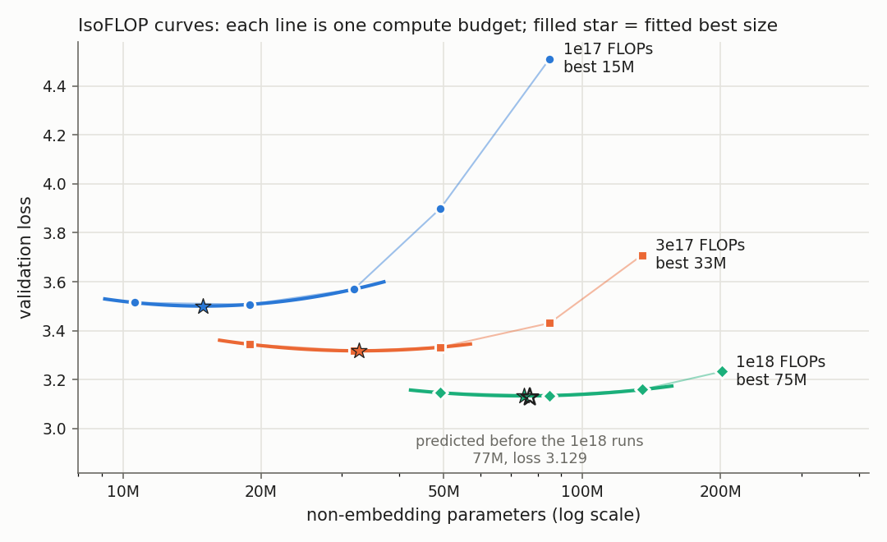
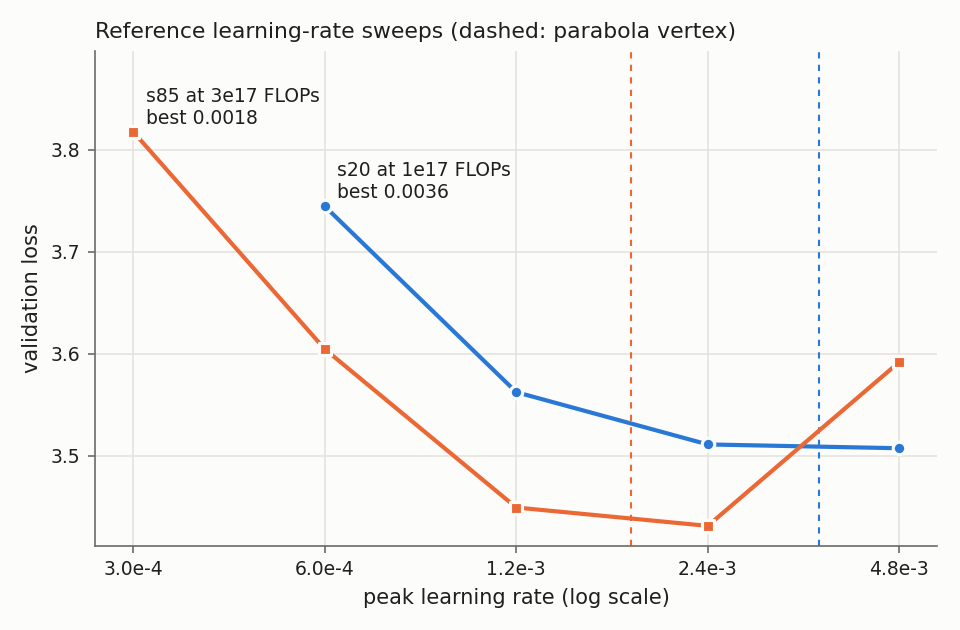
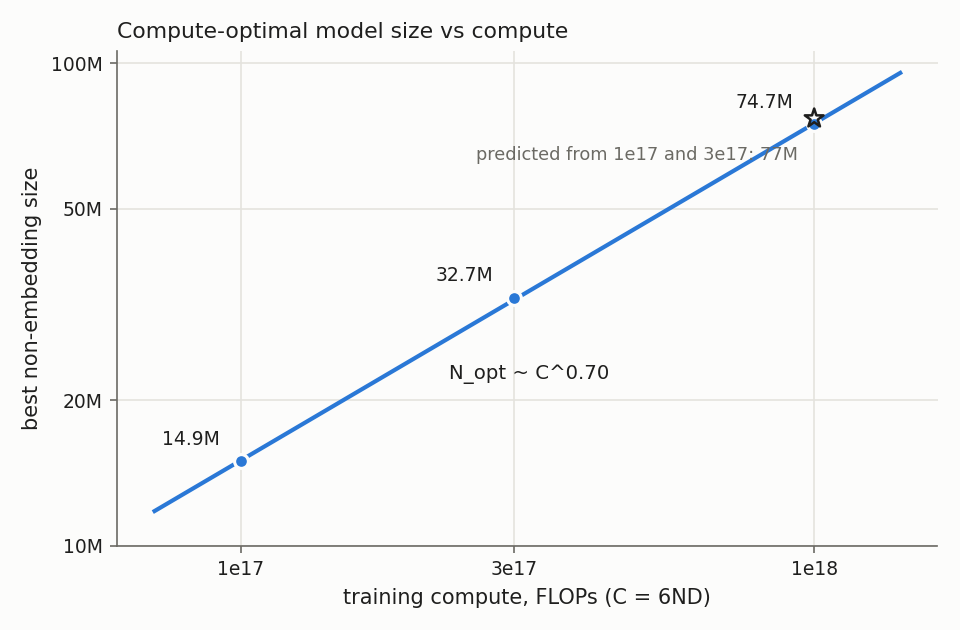

# Step 3: a small scaling-law study (10M to 200M parameters)

The question: for a fixed amount of training compute, how large should a GPT-2-style model be, and
how many tokens should it see? We answer it the way Chinchilla did (Hoffmann et al., 2022,
"Approach 2"): train several model sizes at the same compute budget, find the size with the lowest
loss, and repeat at larger budgets to see how the best size grows. Then we test the trend by
predicting the next budget before training it.

**Result in one paragraph.** At 1e17, 3e17 and 1e18 FLOPs, the compute-optimal model had 14.9M,
32.7M and 74.7M non-embedding parameters, so the best size grows roughly as **C^0.70** and the best
token count as C^0.30. From the first two budgets alone we predicted, and committed before
running it, that the best size at 1e18 would be about 77M with a loss of about 3.13. The measured
values were 74.7M and 3.134. That is inside our uncertainty, which is wide: with one seed per point,
noise of ±0.01 in loss could move the 1e18 optimum anywhere from about 61M to 83M.



## Setup

| | |
|---|---|
| Model | GPT-2 architecture from this repo (`llmtrain/models/gpt.py`), context 1024, vocab 50,304, tied embeddings, head dim 64 |
| Data | FineWeb-Edu `sample-10BT`, GPT-2 tokenizer: 9.944B training tokens, 9.95M validation tokens (same split as step 1). No run sees a token twice. |
| Batch | 262,144 tokens per step (4 GPUs x 16 sequences x 1,024 x 4 accumulation steps; 8 x 8 for s200) |
| Optimizer | AdamW (fused), weight decay 0.1, grad clip 1.0, bf16 autocast, `torch.compile` |
| Schedule | linear warmup over 5% of steps, cosine decay to 10% of the peak, **ending exactly at each run's token budget** |
| Metric | validation loss on the full 9.95M-token validation split at the end of each run |
| Hardware | one AWS SageMaker `ml.g5.12xlarge` (4x A10G 24 GB), us-east-1, torch 2.15.0 + CUDA 13.2, NCCL 2.30.7 |

### Model sizes

N is **non-embedding** parameters, 12 x layers x d_model^2 (Kaplan et al., 2020). Total
parameters add the token and position embeddings.

| Name | Layers | d_model | Heads | N (non-emb.) | Total params | Tokens/s (4 GPUs) | MFU |
|---|---|---|---|---|---|---|---|
| s10 | 6 | 384 | 6 | 10.6M | 30.3M | 406k | 31% |
| s20 | 6 | 512 | 8 | 18.9M | 45.2M | 333k | 38% |
| s35 | 8 | 576 | 9 | 31.9M | 61.4M | 258k | 40% |
| s50 | 10 | 640 | 10 | 49.2M | 82.0M | 221k | 46% |
| s85 | 12 | 768 | 12 | 84.9M | 124.4M | 168k | 53% |
| s135 | 14 | 896 | 14 | 134.9M | 180.9M | 91k | 42% |
| s200 | 16 | 1024 | 16 | 201.3M | 253.9M | 89k | 57% |

MFU is measured against the A10G's measured bf16 matmul peak of 68 TFLOP/s (step 2). Throughput is
the median over each run after its first 10% of steps. s135 is less efficient than its neighbours;
we did not investigate why.

### Compute budgets

Compute is counted as **C = 6 N D** with N non-embedding parameters and D training tokens. Each run's
step count is set so that 6 N D equals its budget: 1e17, 3e17 and 1e18 FLOPs.

## How each run's learning rate was chosen

A scaling-law comparison is only fair if every point is trained near its best learning rate:
a size given a poor learning rate looks worse than it is and moves the minimum. Small models want
higher learning rates than large ones, and short runs want lower ones than long runs.

1. **Sweeps at two reference sizes.** s20 at 1e17 (3,368 steps) over 6e-4 to 4.8e-3, and s85 at
   3e17 (2,246 steps) over 3e-4 to 4.8e-3, each on a factor-2 grid.
2. **Best learning rate per reference.** A parabola in log2(lr) through the lowest point and its two
   neighbours; its vertex is the estimate. If the vertex lies outside the swept range, the code
   refuses to continue (`EdgeError` in `scripts/step3/sweep.py`).
3. **A power law between them,** lr(N) = 3.58e-3 x (N / 18.9M)^-0.451, clipped to [1e-4, 6e-3] and
   rounded to two significant digits. This is a tool for choosing learning rates from two sizes,
   not a measured scaling law.

| Learning rate | 3e-4 | 6e-4 | 1.2e-3 | 2.4e-3 | 4.8e-3 | best (parabola) |
|---|---|---|---|---|---|---|
| s20, 1e17 | | 3.745 | 3.562 | 3.511 | 3.507 | 3.58e-3 |
| s85, 3e17 | 3.818 | 3.604 | 3.449 | 3.431 | 3.592 | 1.82e-3 |



The 1e18 runs used the rule's values: s50 2.3e-3, s85 1.8e-3, s135 1.5e-3, s200 1.2e-3.

### A correction made during the study

The first version of the rule (phase 2) used sweeps whose lowest loss was at the **top edge** of the
grid for both reference sizes, and took the edge value as the best learning rate. For s85 the loss
was still falling by 0.15 per doubling at the edge, so that rule set the larger models' learning
rates too low. We caught it from the data the next morning, extended the s85 sweep (phase 2c), made
the code refuse unbracketed optima, refit, and checked every earlier point against the new rule. All
points already run were within 1.4x of the corrected learning rate and were kept; the one point
the old rule would have run 2x too low (s135 at 3e17) was run only with the corrected value. Both
rules are in this folder (`lr_rule_p2.json`, `lr_rule_p2c.json`; `lr_rule_p3.json` is the same fit
as p2c, with the 1e18 assignments).

## Results

### IsoFLOP curves (validation loss, each size at its best learning rate)

| Budget | s10 | s20 | s35 | s50 | s85 | s135 | s200 | N_opt | D_opt | D/N | L_min |
|---|---|---|---|---|---|---|---|---|---|---|---|
| 1e17 | 3.515 | **3.507** | 3.570 | 3.900 | 4.511 | | | 14.9M | 1.12B | 75 | 3.501 |
| 3e17 | | 3.344 | **3.318** | 3.333 | 3.431 | 3.708 | | 32.7M | 1.53B | 47 | 3.318 |
| 1e18 | | | | 3.147 | **3.135** | 3.159 | 3.233 | 74.7M | 2.23B | 30 | 3.134 |

N_opt and L_min are the vertex of a parabola in ln(N) through the lowest point and its two
neighbours (`scripts/step3/analyze.py`); D_opt = C / (6 N_opt). D/N uses non-embedding parameters.

### The prediction, registered before the 1e18 runs

From the 1e17 and 3e17 curves alone (`prediction_before_1e18.json`, commit `567eb35`, pushed before
phase 3 started), extrapolating N_opt and L_min as power laws in C:

| At 1e18 FLOPs | Predicted | Measured |
|---|---|---|
| N_opt (non-embedding) | 77M | 74.7M |
| D_opt (tokens) | 2.17B | 2.23B |
| L_min | 3.129 | 3.134 |

The prediction held, and it does not depend on the fitting method: a parabola through **all** sizes
at each budget, instead of the three around the minimum, would have predicted about 70M and
measured 75M.

How precise is this? We ran one seed per point. Shifting each 1e18 loss by ±0.01 and refitting
moves N_opt between about 61M and 83M with the all-points parabola (and more with the three-point
one, which is sensitive to a flat bottom). The predicted and measured values agree to within that
range; that they agree to 3% is partly luck.

### How the best size grows with compute



A least-squares line in log-log through the three budgets gives **N_opt proportional to C^0.70**
(and therefore D_opt to C^0.30); the two segments give 0.71 and 0.69. With the all-points
parabola the exponent is 0.65. So the best size grew 5x over a 10x range of compute, and the
tokens-per-parameter ratio fell from 75 to 30.

For comparison, Kaplan et al. (2020) reported an exponent of 0.73 with non-embedding parameters at
small scale, and Hoffmann et al. (2022) about 0.5 with total parameters at much larger scale.
Pearce and Song (2024) argue that most of that gap comes from the parameter counting and the scale.
Our setup is Kaplan's (non-embedding N, small models), and our exponent lands near Kaplan's. That
is consistent with their explanation, but this study does not test it.

### What it cost

| Phase | What | Billed hours (1x g5.12xlarge) | Cost |
|---|---|---|---|
| data | download and tokenize FineWeb-Edu 10BT | 0.18 | $1.27 |
| lr | learning-rate sweep, s20 and s85 at 1e17 | 3.84 | $27.23 |
| p2 | rest of the s20 sweep, s85 at 3e17, 1e17 and 3e17 IsoFLOP points | 11.95 | $84.70 |
| p2c | extended s85 sweep; reruns checked against the corrected rule | 3.56 | $25.21 |
| p3 | the four 1e18 runs | 14.46 | $102.50 |
| **Total** | | **33.98** | **$240.91** |

At the SageMaker on-demand price for us-east-1 ($7.09 per hour). This excludes warm-pool time
between jobs and S3 storage. Phase 2 was stopped on purpose after its 3e17 s50 run, once the
learning-rate problem above was found.

## Caveats

- **Few budgets.** N_opt(C) is fitted through three budgets spanning one decade of compute. The
  exponent is indicative, not precise (0.65 to 0.70 depending on the fit).
- **One seed per point.** Run-to-run noise was not measured; differences below about 0.01 in loss
  should not be read as real. At 3e17 the bottom of the curve is flat (s20, s35 and s50 within
  0.03), so its N_opt is the least certain of the three.
- **Non-embedding counting.** Our tokens-per-parameter ratios are not comparable with Chinchilla's
  "about 20", which counts total parameters at much larger scale. At these sizes the embeddings are
  21% (s200) to 65% (s10) of all parameters.
- **Pure power law.** The loss prediction ignores an irreducible-loss floor. Over one decade it did
  not matter; further out it would make the predicted loss too optimistic.
- **Short runs.** Points with fewer than about 1,500 steps (s85 at 1e17, s50 at 1e17, s135 at 3e17)
  prefer lower learning rates than the rule gives (s85 at 1e17 did best at 6e-4, the bottom of its
  grid). They sit on the large-model side of each curve, so they shape its right edge more than its
  minimum.
- **s10 at 1e17** ran at 6e-3, the clip of the first rule. The corrected rule gives 4.6e-3 (1.3x
  lower); it was kept under the 1.4x criterion above.
- **s200's learning rate** extrapolates the rule 2.4x beyond its largest reference size.
- **HellaSwag** stayed near chance (24-28%) for every run, so it is reported in the raw results but
  not used.

## Reproducing

The runs ran as SageMaker training jobs that clone this repository's `step3-scaling` branch.
`sagemaker/submit.py` holds the account, bucket and IAM role used here; change them for your own
account. The role needs SageMaker, S3 and CloudWatch Logs access, and the account needs a quota for
one `ml.g5.12xlarge` training instance.

```bash
export AWS_DEFAULT_REGION=us-east-1
# 1. data: FineWeb-Edu sample-10BT -> GPT-2 tokens -> s3://BUCKET/data/fineweb-edu-10bt/ (about 11 minutes)
python sagemaker/submit.py --name prep-data --cmd 'bash sagemaker/jobs/prep_data.sh'
# 2. the four phases, in order; each reads the earlier phases' results from S3
python sagemaker/submit.py --name step3-lr  --data fineweb-edu-10bt --results step3/lr  --max_hours 7 \
  --cmd 'python scripts/step3/sweep.py --phase lr'
python sagemaker/submit.py --name step3-p2  --data fineweb-edu-10bt --results step3/p2  --max_hours 18 \
  --cmd 'python scripts/step3/sweep.py --phase p2 --prior_results s3://$BUCKET/step3/lr/results.jsonl'
python sagemaker/submit.py --name step3-p2c --data fineweb-edu-10bt --results step3/p2c --max_hours 14 \
  --cmd 'python scripts/step3/sweep.py --phase p2c --prior_results s3://$BUCKET/step3/lr/results.jsonl s3://$BUCKET/step3/p2/results.jsonl'
python sagemaker/submit.py --name step3-p3  --data fineweb-edu-10bt --results step3/p3  --max_hours 22 \
  --cmd 'python scripts/step3/sweep.py --phase p3 --prior_results s3://$BUCKET/step3/lr/results.jsonl s3://$BUCKET/step3/p2/results.jsonl s3://$BUCKET/step3/p2c/results.jsonl'
# 3. analysis and charts, from the results in this folder
python scripts/step3/analyze.py results/step3_scaling/results_*.jsonl --predict 3e18 1e19 --out results/step3_scaling/analysis.json
python scripts/step3/plots.py --dir results/step3_scaling
```

`python scripts/step3/sweep.py --phase <phase> --dry_run` prints a phase's run table without
training. A rerun with the same `--results` prefix skips runs that already finished. Note that the
p2 job here was stopped before its last run (see above), so a full p2 run trains one more point
(s135 at 3e17 with the first rule) than we did.

## Files

| File | What |
|---|---|
| `results_lr.jsonl`, `results_p2.jsonl`, `results_p2c.jsonl`, `results_p3.jsonl` | one summary per run: size, budget, tokens, learning rate, final losses, hours |
| `lr_rule_p2.json`, `lr_rule_p2c.json`, `lr_rule_p3.json` | the first (edge-based) and corrected learning-rate rules, with the sweep points used and the rate assigned to each run |
| `prediction_before_1e18.json` | the 1e18 prediction, written before any 1e18 run |
| `analysis.json` | IsoFLOP fits for all three budgets, exponents, and extrapolations to 3e18 and 1e19 |
| `isoflop.png`, `n_opt.png`, `lr_sweeps.png` | the charts above (`scripts/step3/plots.py`) |
